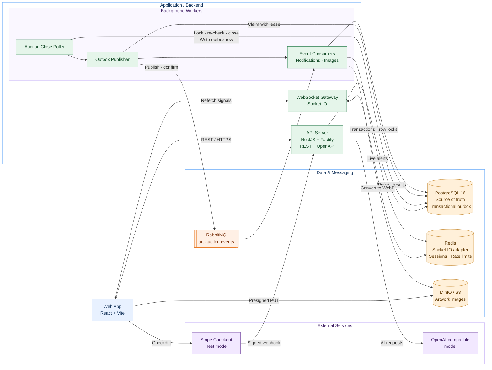

# Art Auction House

A real-time marketplace for original art. Collectors place proxy bids, follow auctions live, pay through Stripe Checkout (test mode), and artists earn royalties when their work is resold.

**Stack:** TypeScript · NestJS · Fastify · PostgreSQL · RabbitMQ · Redis · MinIO · React · Vite

---

## Architecture



The API serves HTTP and real-time connections. A separate worker handles auction closing, event publishing, notifications, and image processing. PostgreSQL is the source of truth; the API does not publish directly to RabbitMQ.

---

## Design Highlights

- **Concurrent bidding:** Proxy bids are resolved in a short PostgreSQL transaction using a row-level lock.
- **Safe auction closing:** The close worker locks and re-checks the auction before closing it, avoiding races with late bids.
- **Transactional outbox:** Auction outcomes and outbox events are written in the same transaction. A leased publisher sends events to RabbitMQ with publisher confirms.
- **Reliable consumers:** Event delivery is at least once; consumers are idempotent.
- **Verified payments:** A verified Stripe webhook, not the browser redirect, confirms payment.
- **Double-entry ledger:** Ledger entries must sum to zero. Corrections are recorded as reversing transactions.
- **Safer image uploads:** The browser uploads to MinIO/S3 using presigned URLs. Workers validate image bytes, strip EXIF/GPS data, and generate WebP versions.
- **Constrained AI tools:** Concierge tools are read-only, use strict schemas, and derive identity from the request rather than model output.


---

## Run Locally

**Requirements:** Node.js 22.9+ and Docker. On Windows, use Docker Desktop with WSL integration.

```sh
cp .env.example .env
npm install
npm start
```

`npm start` starts the infrastructure, applies migrations, seeds the demo catalog when needed, and runs the API, worker, and web app.

| Service | URL |
|---|---|
| Web app | http://localhost:5201 |
| API | http://localhost:4101/api |
| API docs | http://localhost:4101/api/docs |
| Jaeger traces | http://localhost:16697 |
| RabbitMQ management | http://localhost:15677 |

There is no real authentication in this demo. Choose a user from **Viewing as** in the web app; the client sends `X-Demo-User-Id`.

---

## Try It Out

- **Live bidding:** Open two browser tabs as different demo users and bid on the same auction.
- **Soft close:** Place a bid near the end of an auction to see the closing time extend.
- **Outcomes:** Let an auction close and check the result and notification.
- **Payments and royalties:** Configure Stripe test keys, win an auction, and use the Stripe test card `4242 4242 4242 4242`.
- **Images:** Add artwork photos and watch them move through processing.
- **AI:** Set `OPENAI_API_KEY` to enable Concierge and model-powered search. Search falls back to keywords without a key.

### Stripe Test Mode

1. Add `STRIPE_SECRET_KEY=sk_test_...` to `.env`.
2. Install the [Stripe CLI](https://docs.stripe.com/stripe-cli).
3. Start webhook forwarding:

   ```sh
   stripe listen --api-key "$(grep '^STRIPE_SECRET_KEY=' .env | cut -d= -f2)" \
     --events checkout.session.completed \
     --forward-to localhost:4101/api/webhooks/stripe
   ```

4. Add the printed `whsec_...` value as `STRIPE_WEBHOOK_SECRET` and restart the app.

---

## Testing

| Command | Purpose |
|---|---|
| `npm test` | Server unit tests |
| `npm run test:integration` | Database, concurrency, outbox, ledger, and webhook tests |
| `npm run test:e2e` | API end-to-end tests |
| `npm run test:web` | Frontend tests |

Integration and end-to-end tests require infrastructure to be running:

```sh
npm run infra:up
```

Tests use local services and fakes; they do not require live payment credentials or an LLM API key.

---

## Useful Commands

| Command | Purpose |
|---|---|
| `npm run infra:up` / `npm run infra:down` | Start / stop Docker services |
| `npm run db:reset` | Recreate the database |
| `npm run migrate` | Apply migrations |
| `npm run seed` | Seed demo data |
| `npm run seed:images` | Attach public-domain images (requires network) |
| `npm run typecheck` | Typecheck server and web |
| `npm run docs:openapi` | Regenerate the OpenAPI spec |

---

## Project Structure

```text
server/src/common     Shared utilities, validation, tracing, errors
server/src/database   PostgreSQL pool, migrations, seed
server/src/modules    Auctions, bidding, closing, outbox, payments,
                      ledger, images, search, assistant, realtime
server/test           Unit, integration, and end-to-end tests
web/src               React application
docs/adr              Architecture decision records
```

---

## Scope & Known Limitations

- Demo identity only; production authentication is not implemented.
- Stripe is test mode only. Seller and artist payouts are not implemented; the ledger tracks amounts owed.
- Currency is USD, stored in integer cents.


---

## License

See [LICENSE](LICENSE).
